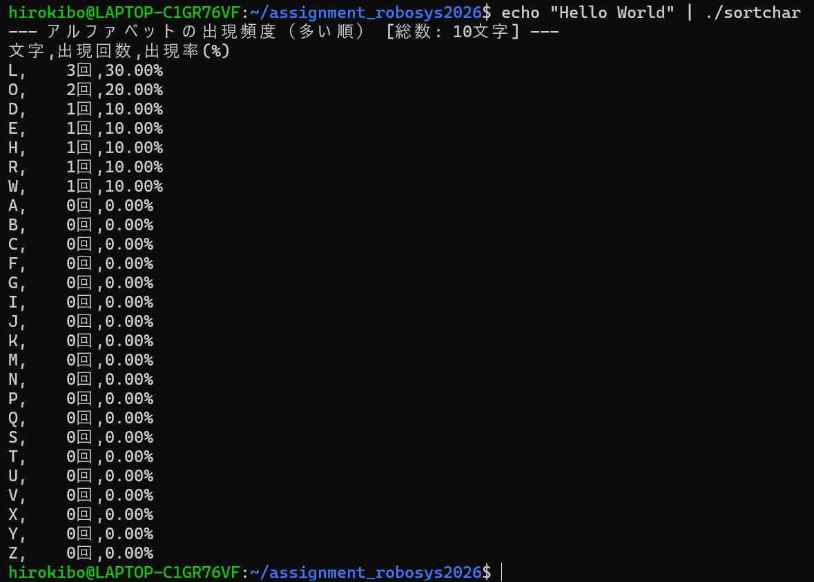
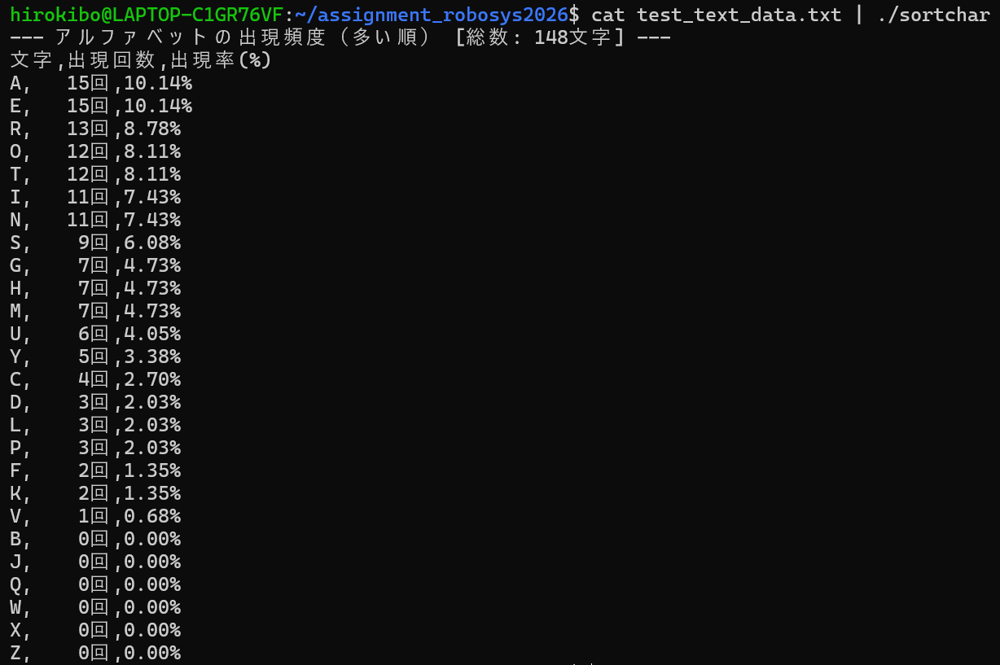

# sortcharコマンド

## 何をするためのソフトか

- 標準入力からa~zまでの文字を昇順でカウント、出現率を表示する。

### 使い方,例(必要な方はどうぞ)
1. 任意のディデクトリにファイルを作り、sortcharのソースコードをコピーする。(例:ファイル名:sortchar)
2. chmodコマンドでそのファイルに実行権限を付与する。(例:chmod +x sortchar)
3. echoコマンドとsortcharをパイプ(｜)で繋げて、実行する。(例:echo "Hello World" | ./sortchar) 

実行結果

おまけ
(cat 任意のテキストデータ名.txt | ./sortchar)

## 必要なソフトウェア
- Python
  - テスト済みバージョン: 3.10〜3.14

## テスト環境
- Ubuntu 24.04 LTS

## 免責事項
あくまで授業で出された課題です。コードの使用は、自己責任でお願いします。

## 著作権とLICENSE

- このソフトウェアパッケージは、3条項BSDライセンスの下、再頒布および使用が許可されます。
- このパッケージのコードは、下記のスライド（CC BY-SA 4.0 by Taro Suzuki）のものを、
  本人の許可を得て自身の著作としたものです。
    - https://github.com/tarolab-cit/lectures/tree/main/robosys2026
- © 2026 Hiroki Ueno
